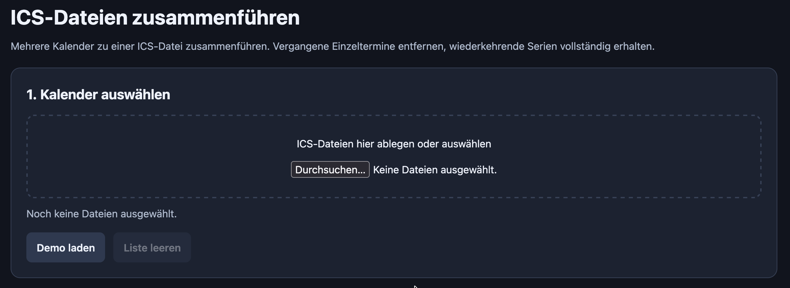
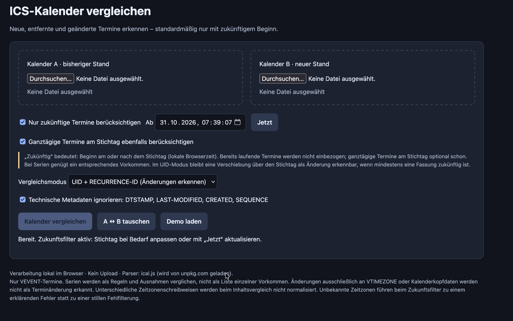

+++
title = "Calendar - Chaos - Compromise"
date = 2026-09-30 12:00:00+01:00
description = "Juggling family, work, and a homelab takes good time management. Keeping calendars up to date is essential—so at least your own shortcomings are the only thing left to trip you up. Two little tools I had built today to help me keep track of my appointments and tasks."
[taxonomies]
tags = ["calendar", "chaos", "compromise", "homelab", "nextcloud", "office365", "microsoft", "citrix"]
[extra]
comment = true
+++

## The Problem: A Locked-Down System vs. Open Source

Some of you might be familiar with this problem. Your work computer is completely locked down, and you can’t install any software. In my case, I can’t subscribe to external calendars in my work calendar either. Meanwhile, my wife and I keep our appointments in Nextcloud.

So I have two separate calendar worlds that I can’t simply merge automatically. And it’s genuinely frustrating, because somehow it creates more work than it saves. The personal appointment is in Nextcloud, the meeting is in my work calendar, and I’m stuck in the middle, hoping I haven’t forgotten anything.

Family, work, and then all the things I’d actually like to do on my server… that takes a bit of time management. Or at least a calendar that tells me why I don’t have any time right now.

## The Approach: Two Little Tools

My current approach is to regularly export an .ics file from my Nextcloud calendars and then import it into my work calendar. Not particularly elegant, but it works.

The biggest problem, of course, is me. I don’t do it regularly, and then appointments go missing again. So I’ve now set up a recurring task in my to-do list. A task that reminds me to maintain my other organizational aid. Oh well.

To at least make merging and comparing the calendars less of a chore, I had GPT-6.1 Sol build me two little tools.

### Tool 1: Calendar Merger

I have five calendars in Nextcloud: my personal calendar, my work calendar, our family calendar, my wife’s personal calendar, and her work calendar.

When I export them, I get each calendar separately. For the import, though, I’d prefer a single file. So now there’s a little tool on my server that merges the exported calendars into one .ics file.

The useful part is that I can filter appointments by date. I don’t need the last few years of our family’s scheduling history in my work calendar. I mainly want to see what’s coming up.

Calendar Merger is built with plain HTML, CSS, and JavaScript. I host it on my server so I can access it from anywhere. Select the calendar files, set a date range, merge, and download.

It worked well on the first try. I was able to import the upcoming appointments from all our calendars into my work calendar in one go. Already much nicer than dealing with each file individually.

Here’s the [Calendar Merger](download/terminmerger.html).

### Tool 2: Calendar Differ

After the first import, the next question is obvious: which of these appointments will already be in my work calendar next time?

That’s what the second tool, Calendar Differ, is for. It compares the appointments in my work calendar with those in the Nextcloud calendars. From that comparison, I can generate an .ics file containing only the appointments that are still missing from my work calendar.

Of course, I need to export the calendars as .ics files first. So there’s still some manual work involved. But I no longer have to figure out for myself which appointments I’ve already transferred and which ones I haven’t.

Here, too, I can filter by date and focus on upcoming appointments. And this tool is also just HTML, CSS, and JavaScript.

Here’s the [Calendar Differ](download/termindiffer.html).

## Really, I Don’t Want to Keep Doing This Manually

Of course, I plan to automate all of this eventually. Exporting, merging, comparing, and reimporting calendars isn’t something I want to spend my free time doing in the long run.

Ultimately, I’d like an automatic sync between Nextcloud and Office365, as far as my workplace’s policies allow. I still need to figure out exactly how to make that happen. The restrictions don’t disappear just because I’d prefer a more convenient solution.

Until then, these two tools are my **compromise**. They don’t solve the whole problem, but they do take one annoying part of it off my hands.

And I don’t have to finish the entire automation project before anything gets better. That’s really the key point for me. Otherwise, something like this quickly ends up on the list of things I’d like to “do properly someday.” That list is long enough already.

## It Doesn’t Always Have to Be Python

One thing this reminded me of: a lot of people I know genuinely have no idea how quickly you can have AI build little helpers like these nowadays.

I don’t mean a huge application or the next big business idea. Just mundane things that get on your nerves in everyday life. Comparing two files. Reordering a list. Combining several calendars into one.

With AI, the first draft of a little tool like this can sometimes be ready in seconds. Then you try it out, see what still needs work, and have it refined. That doesn’t mean everything works correctly straight away. But getting from “surely there’s an easier way to do this” to a first usable version no longer has to take an entire evening.

And most importantly: you don’t necessarily have to install Python, download packages, or figure out why a script won’t run on your computer.

For little tasks like these, a single HTML file with the interface and JavaScript included is often enough. You open it in your browser. Done. No terminal, no server of your own, and no extra application to install.

I host my two tools on my server because that’s convenient for me. But for a self-contained HTML tool built that way, that isn’t necessary at all. The file can just as easily live on your own computer.

So you can be quite specific when asking the AI: “Build this as a single HTML file that I can open locally in my browser, with no installation and no external dependencies.”

For people who don’t work with this sort of thing all the time, that might be the more interesting takeaway than my actual calendar problem. You don’t have to start building a homelab just because you want to compare two files. Although, of course, I have nothing against another homelab.

## A Little Less Chaos for Now

These two tools aren’t a complete calendar synchronization solution. They work with the files I give them. If I don’t export and import anything, nothing happens. And before I import a whole batch of appointments, I prefer to take another look at the results.

But they make the current process easier. And that’s enough for now.

The automation will come later. Until then, I have two little helpers that take some work off my hands. Now I just need to pay attention to the reminder in my to-do list.