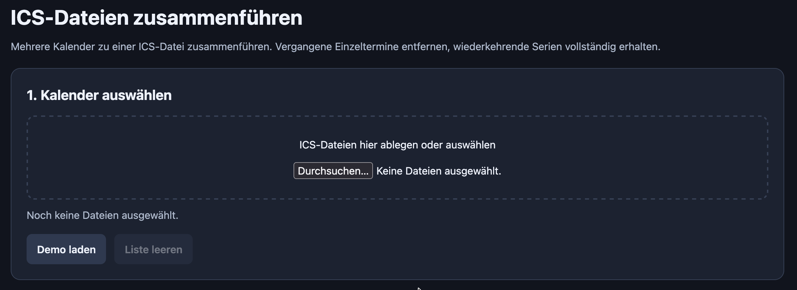
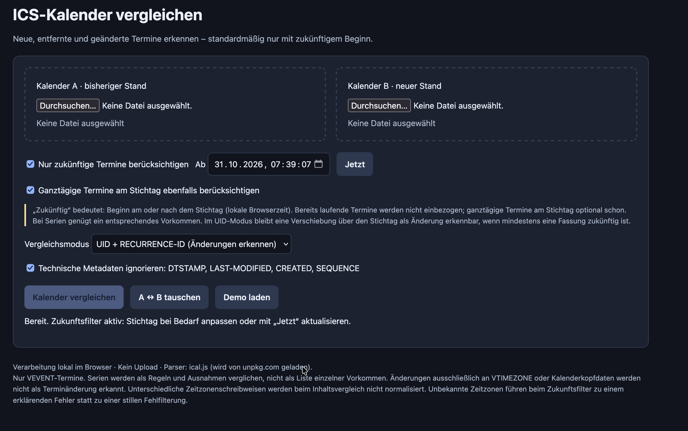

+++
title = "Calender - Chaos - Compromise"
date = 2026-09-30 12:00:00+01:00
description = "Familie, Arbeit und Homelab unter einen Hut bringen, dafür braucht man ein gutes Zeitmanagement. Zuverlässig geführte Kalender sind das A und O, damit man nur an der eigenen Unzulänglichkeit scheitert. Zwei kleine Tools, die ich heute habe bauen lassen, damit ich meine Termine und Aufgaben im Griff habe."
[taxonomies]
tags = ["calendar", "chaos", "compromise", "homelab", "nextcloud", "office365", "microsoft", "citrix"]
[extra]
comment = true
+++

## Das Problem: Abgeschlossenes System vs. Open Source

Vielleicht kennt der ein oder andere das Problem. Der Arbeitsrechner ist völlig verriegelt und man kann keine Software installieren. In meinem Fall kann ich auch keine externen Kalender im Arbeitskalender abonnieren. Auf der anderen Seite pflegen meine Frau und ich unsere Termine in Nextcloud.

Ich habe also zwei Kalenderwelten, die ich nicht einfach automatisch zusammenführen kann. Und das ist wirklich mühsam, weil es irgendwie mehr Arbeit schafft, als es einem abnimmt. Der private Termin steht in Nextcloud, die Besprechung im Arbeitskalender und ich stehe dazwischen und hoffe, dass ich an alles gedacht habe.

Familie, Arbeit und dann noch die Dinge, die ich eigentlich gerne am Server machen würde ... dafür braucht es schon ein bisschen Zeitmanagement. Oder wenigstens einen Kalender, in dem steht, warum man gerade keine Zeit hat.

## Der Weg: Zwei kleine Tools

Mein aktueller Weg ist, regelmäßig aus meinen Nextcloud-Kalendern eine .ics-Datei zu exportieren und diese dann in den Arbeitskalender zu importieren. Nicht besonders elegant, aber es funktioniert.

Das größte Problem dabei bin natürlich ich selbst. Ich mache das nicht regelmäßig und dann fehlen wieder Termine. Dafür habe ich mir mittlerweile eine wiederkehrende Aufgabe in meiner ToDo-Liste eingerichtet. Eine Aufgabe, die mich daran erinnert, meine andere Organisationshilfe zu pflegen. Naja.

Damit zumindest das Zusammenführen und Vergleichen weniger Arbeit macht, habe ich mir zwei kleine Tools von GPT-6.1 Sol bauen lassen.

### Tool 1: Terminmerger

Ich habe fünf Kalender in Nextcloud: meinen privaten Kalender, meinen Arbeitskalender, unseren Familienkalender, den privaten Kalender meiner Frau und ihren Arbeitskalender.

Beim Export bekomme ich die Kalender einzeln. Für den Import hätte ich aber gerne eine einzige Datei. Deshalb gibt es jetzt ein kleines Tool auf meinem Server, das die exportierten Kalender zusammenführt und mir daraus eine .ics-Datei erstellt.

Das Praktische ist, dass ich die Termine nach Datum filtern kann. Ich brauche ja nicht die letzten Jahre unserer Familienorganisation im Arbeitskalender, sondern möchte vor allem sehen, was demnächst ansteht.

Der Terminmerger besteht einfach aus HTML, CSS und JavaScript. Ich habe ihn auf meinem Server liegen, damit ich ihn von überall aufrufen kann. Kalenderdateien auswählen, Zeitraum festlegen, zusammenführen und herunterladen.

Beim ersten Versuch hat das gut funktioniert. Ich konnte die zukünftigen Termine aus unseren Kalendern gesammelt in meinen Arbeitskalender importieren. Schon mal deutlich angenehmer, als jede Datei einzeln anzufassen.

Hier geht es zum [Terminmerger](download/terminmerger.html).

### Tool 2: Termindiffer

Nach dem ersten Import kommt natürlich die nächste Frage: Was davon ist beim nächsten Mal schon im Arbeitskalender?

Dafür gibt es das zweite Tool, den Termindiffer. Der stellt die Termine aus meinem Arbeitskalender und den Nextcloud-Kalendern gegenüber. Daraus kann ich eine .ics-Datei erstellen lassen, die nur die Termine enthält, die im Arbeitskalender noch fehlen.

Voraussetzung ist, dass ich die Kalender vorher als .ics-Dateien exportiert habe. Ein bisschen Handarbeit bleibt also. Aber ich muss nicht mehr selbst herausfinden, welchen Termin ich schon übertragen habe und welchen nicht.

Auch hier kann ich nach Datum filtern und mich auf zukünftige Termine beschränken. Und auch dieses Tool ist nur HTML, CSS und JavaScript.

Hier geht es zum [Termindiffer](download/termindiffer.html).

## Eigentlich will ich das gar nicht mehr selbst machen

Natürlich habe ich vor, das alles noch zu automatisieren. Kalender exportieren, zusammenführen, vergleichen und wieder importieren ist jetzt nichts, womit ich auf Dauer meine freie Zeit verbringen möchte.

Am Ende hätte ich gerne einen automatischen Abgleich zwischen Nextcloud und Office365, soweit das mit den Vorgaben meines Arbeitsumfelds möglich ist. Wie genau ich das löse, muss ich mir noch anschauen. Die Einschränkungen verschwinden ja nicht dadurch, dass ich gerne eine bequemere Lösung hätte.

Bis dahin sind die beiden Tools mein Kompromiss. Sie lösen nicht das ganze Problem, aber sie nehmen mir schon mal einen nervigen Teil davon ab.

Und ich muss nicht erst das komplette Automatisierungsprojekt fertig haben, bevor sich irgendetwas verbessert. Das ist für mich eigentlich der entscheidende Punkt. Sonst landet so etwas schnell auf der Liste mit den Dingen, die ich „irgendwann mal ordentlich“ machen möchte. Die Liste ist lang genug.

## Es muss nicht immer gleich Python sein

Was mir dabei wieder aufgefallen ist: Viele in meinem Umfeld wissen tatsächlich gar nicht, wie schnell man sich solche kleinen Helfer mittlerweile mit KI bauen lassen kann.

Ich meine damit keine riesige Anwendung und auch nicht die nächste Geschäftsidee. Sondern ganz banale Dinge, die einen im Alltag nerven. Zwei Dateien vergleichen. Eine Liste umsortieren. Aus mehreren Kalendern einen machen.

Seit es KI gibt, ist der erste Entwurf für so ein kleines Tool teilweise innerhalb von Sekunden da. Dann ausprobieren, schauen, was noch nicht passt, und nachbessern lassen. Das heißt nicht, dass sofort alles richtig funktioniert. Aber zwischen „das müsste man doch irgendwie einfacher machen können“ und einem ersten brauchbaren Versuch liegt plötzlich nicht mehr unbedingt ein ganzer Abend.

Und vor allem: Man muss dafür nicht zwangsläufig Python installieren, irgendwelche Pakete nachladen oder erst herausfinden, warum ein Script auf dem eigenen Rechner nicht startet.

Für solche kleinen Aufgaben reicht oft eine einzelne HTML-Datei, in der Oberfläche und JavaScript schon enthalten sind. Die öffnet man im Browser. Fertig. Kein Terminal, kein eigener Server und keine Installation einer zusätzlichen Anwendung.

Ich habe meine beiden Tools zwar auf meinem Server liegen, weil das für mich praktisch ist. Für ein entsprechend gebautes, in sich abgeschlossenes HTML-Tool ist das aber gar nicht nötig. Die Datei kann genauso gut auf dem eigenen Rechner liegen.

Man kann der KI also ruhig ganz konkret sagen: „Bau mir das als einzelne HTML-Datei, die ich lokal im Browser öffnen kann, ohne Installation und ohne externe Abhängigkeiten.“

Das ist für Leute, die nicht ständig mit solchen Dingen arbeiten, vielleicht der interessantere Hinweis als mein eigentliches Kalenderproblem. Man muss nicht erst anfangen, ein Homelab aufzubauen, nur weil man zwei Dateien vergleichen möchte. Auch wenn ich natürlich grundsätzlich nichts gegen ein weiteres Homelab habe.

## Erst mal weniger Chaos

Die beiden Tools sind keine fertige Kalendersynchronisation. Sie arbeiten mit den Dateien, die ich ihnen gebe. Wenn ich nichts exportiere und importiere, passiert auch nichts. Und bevor ich einen ganzen Schwung Termine übernehme, schaue ich mir das Ergebnis lieber noch einmal an.

Aber sie machen den aktuellen Ablauf einfacher. Und das reicht mir fürs Erste.

Die Automatisierung kommt noch. Bis dahin habe ich zwei kleine Helfer, die mir ein bisschen Arbeit abnehmen. Jetzt muss ich nur noch auf die Erinnerung in meiner ToDo-Liste hören.